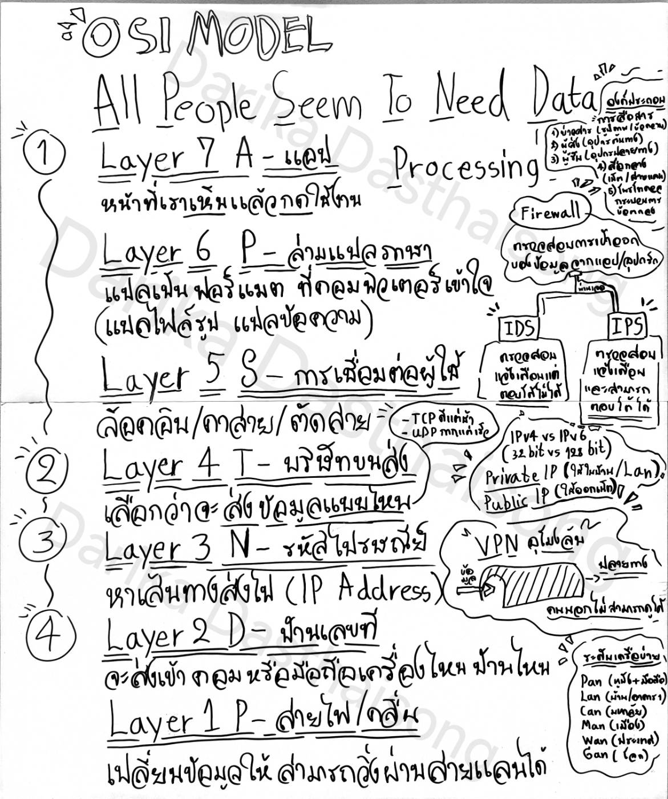
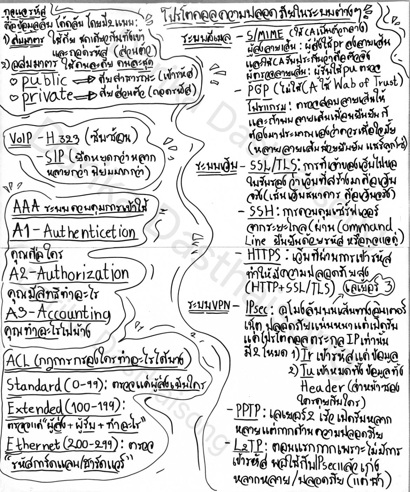
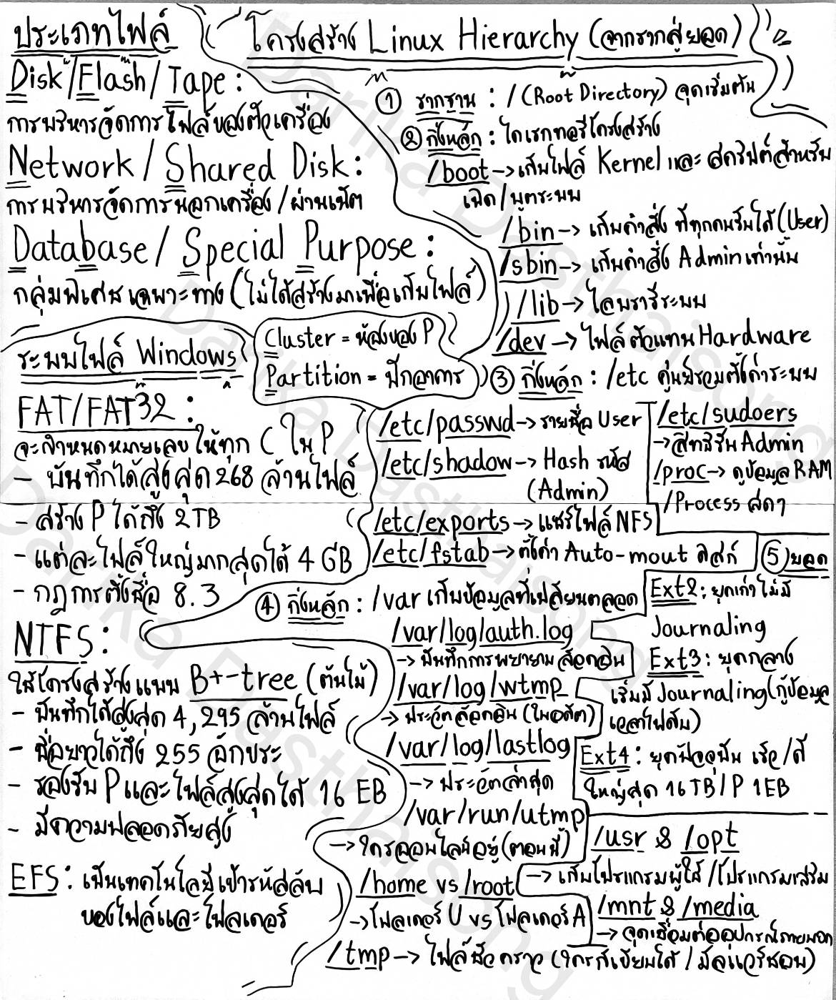
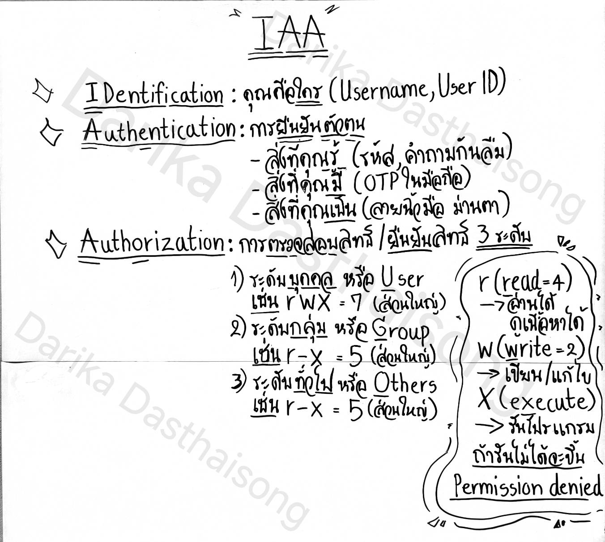
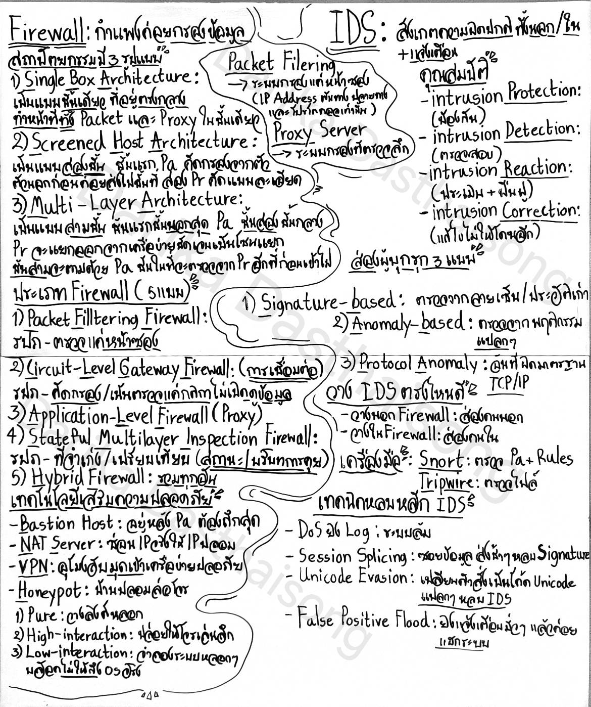

# network-security-notes
เอกสารนี้จัดทำขึ้นเพื่อการเรียนรู้ส่วนบุคคล ห้ามนำไปใช้ในเชิงพาณิชย์โดยไม่ได้รับอนุญาต

*เนื้อหาอาจมีข้อผิดพลาดบางประการเนื่องจากเป็นบันทึกจากการศึกษาด้วยตนเอง*

## 📌 สรุปเนื้อหาทั้งหมด

### 1. OSI Model & Network Fundamentals

### 2. Security Protocols, Encryption, AAA & ACL

### 3. Linux Directory Structure & File Systems

### 4. IAA (Identification, Authentication, Authorization) & Permissions

### 5. Firewall Architectures & IDS/IPS Detection

